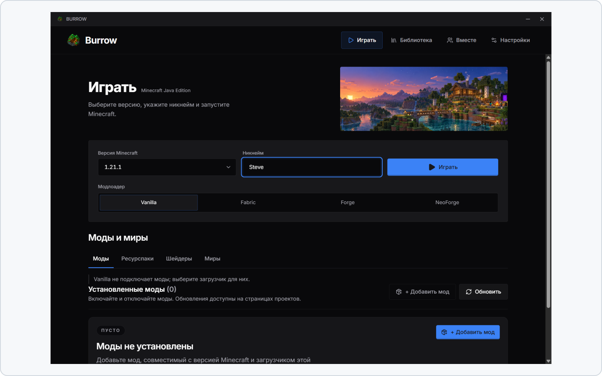
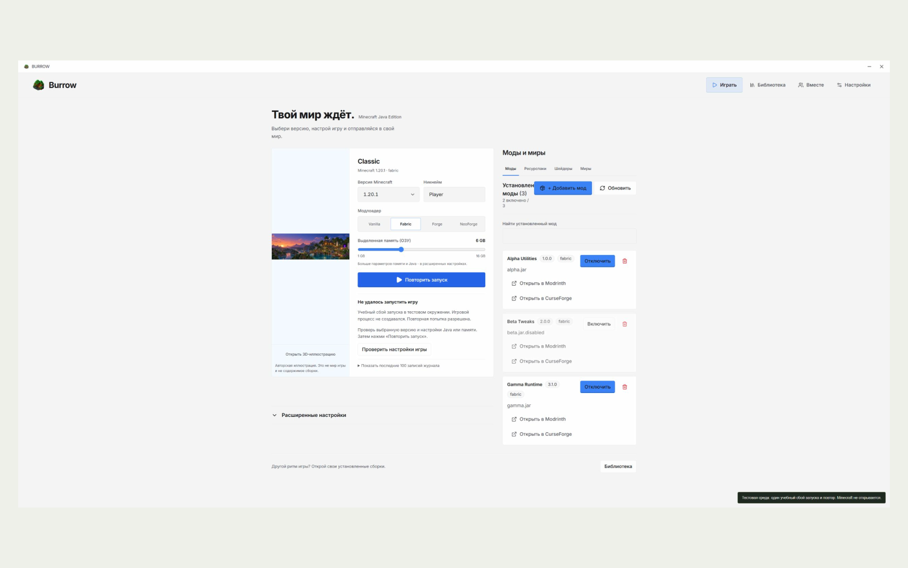
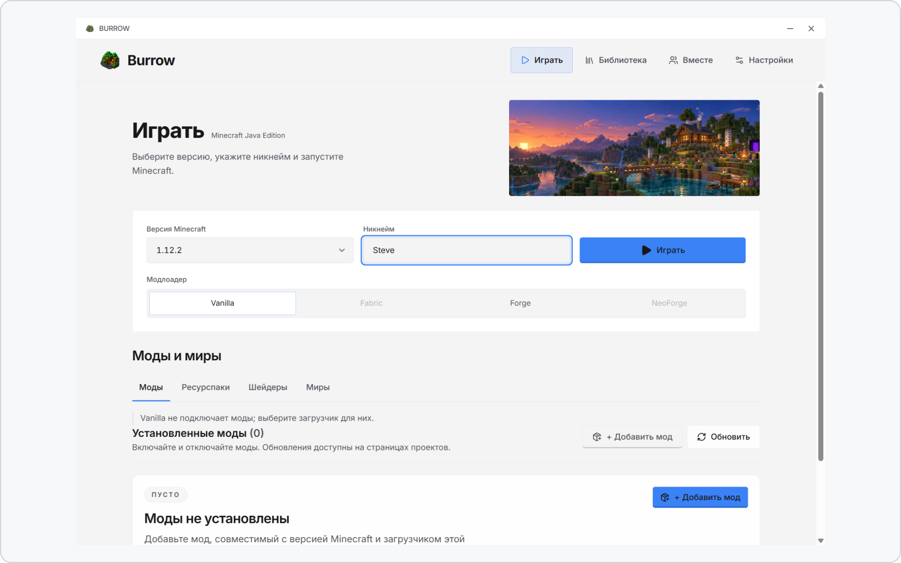
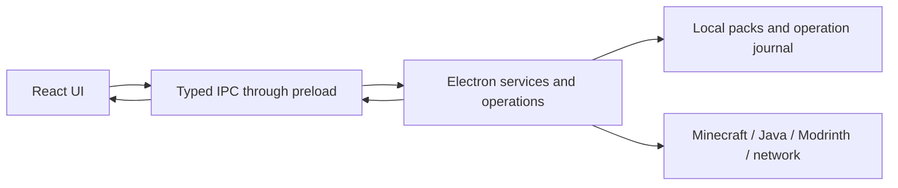

# Burrow

A desktop Minecraft launcher for your own modpacks and playing with friends. Pick a game version and modloader, add mods, and launch from one library.

**[Run the current preview](#run)** · [Watch the 21-second demo](docs/assets/readme/current-flow.mp4) · [Русский](README.md)

The current preview runs from source. The [0.13.0 installers](https://github.com/376east/burrow/releases/tag/v0.13.0) are archived.

<p><a href="#status-and-limitations"></a> <a href="https://github.com/376east/burrow/actions/workflows/ci.yml"></a> <a href="package.json"></a> <a href="docs/assets/readme/current-flow.mp4"></a></p>

**[Screenshots](#screenshots) · [Features](#implemented-features) · [Run](#run) · [Architecture](#architecture) · [Limitations](#status-and-limitations) · [Development](#development)**

## Screenshots

<a href="docs/assets/readme/overview.svg"></a>

Launch preparation now explains readiness; a failed launch offers settings, logs, and retry. These renderer-fixture captures use a fictional pack and a simulated failure. They do not demonstrate a real Minecraft launch. [Capture source](docs/assets/readme/prototype-transfer.json).

**[Current MP4 demo](docs/assets/readme/current-flow.mp4)** · 00:21 · 26 October 2026 · [Capture details](docs/assets/readme/current-flow.json)

[Previous demo, 00:52](docs/assets/demo/burrow-next-demo.mp4) · [Demo materials](docs/DEMO.md)

<details>
<summary>Two more screens</summary>

**Launch error and retry.**

<a href="docs/assets/readme/screen-2.svg"></a>

**Recovery on a narrow screen.**

<a href="docs/assets/readme/screen-3.svg"></a>

</details>

## Implemented features

- **Main flow:** choose Minecraft and a modloader, enter a nickname, configure memory and Java, and launch the game. [Play screen](src/product/PlayWorkspace.tsx), [launcher](electron/services/launcher).
- **More features:** create and import packs, install Modrinth modpacks, manage mods, resource packs, shaders, worlds and screenshots, export packs and connect through Burrow Link; change theme and language. [Library](src/components/modpacks), [content](electron/services), [multiplayer](src/product/FriendsWorkspace.tsx), [settings](src/product/SettingsWorkspace.tsx).
- **Data:** local packs, settings and an operation journal; the UI calls Electron services through typed IPC. [Architecture](docs/en/architecture.md).

## Run

### Requirements

Node.js 24.x, npm 11.x and Git: [versions](package.json), [.nvmrc](.nvmrc).

### Quick start

```powershell
git clone https://github.com/376east/burrow.git
cd burrow
npm ci
npm run dev
```

### Data and access

This runs the current preview from source: `npm run dev` opens Electron through Vite ([configuration](vite.config.ts)). No API keys are required for ordinary use. Optional variables are listed in [`.env.example`](.env.example); commands and environment setup are in the [development guide](docs/en/development.md).

[Older installers in GitHub Releases](https://github.com/376east/burrow/releases/latest) belong to the previous product line and remain as an archive. Use the source instructions above for the current preview. `npm run build -- --publish never` builds locally without publishing.

The default branch is `master`; the previous version is preserved in the archive branch. [Archive and rollback](docs/REPOSITORY.md).

## Architecture



Actions cross [IPC wrappers](src/services/ipc) and [contracts](shared/contracts). Main validates requests, performs operations and returns updated state. Filesystem ownership stays in main, assembled in one [composition root](electron/app/compositionRoot.ts). [Architecture](docs/en/architecture.md).

## Status and limitations

| Parameter | State |
| --- | --- |
| Stage | In development. [Plan](PLAN.md). |
| Version | 0.14.0, preview. [package.json](package.json). |
| License | MIT for the project code. [LICENSE](LICENSE), [third-party components](THIRD_PARTY_NOTICES.md). |

### Limitations

Microsoft authentication and Quilt are unavailable. The CurseForge catalog is disabled in official builds; archive imports that download mods need an available provider. Burrow Link depends on the network and needs verification on two devices. [Detailed limitations](docs/en/known-issues.md).

[CI](https://github.com/376east/burrow/actions/workflows/ci.yml) checks code and the macOS Chromium UI. This does not establish compatibility with every game version, modloader, or network; real game installations and Windows/macOS/Linux packages need separate checks. [Check coverage](docs/en/testing.md), [verified behavior and remaining work](PLAN.md).

## Development

[Documentation](docs/README.md) · [Plan](PLAN.md) · [Rules](AGENTS.md) · [CI](https://github.com/376east/burrow/actions/workflows/ci.yml)

<details>
<summary>Checks and development</summary>

Commands, environment setup, and project structure are in the [development guide](docs/en/development.md) and [architecture](docs/en/architecture.md). Read [contributing](CONTRIBUTING.md) and [AGENTS.md](AGENTS.md) before making changes. [Demo reproduction](docs/DEMO.md).

[Documentation](docs/README.md#english) · [Contributing](CONTRIBUTING.md) · [Security](SECURITY.md) · [Changelog](CHANGELOG.md)

The existing [MIT license](LICENSE) applies to code. Minecraft and third-party components retain their own terms: [notices](THIRD_PARTY_NOTICES.md). Burrow is not affiliated with Mojang or Microsoft.

[Checks and commands](docs/AGENT_GUIDE.md) · [37.6 East](https://github.com/376east)

[Русский](README.md).

</details>
