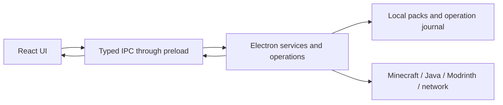

# Burrow

A desktop Minecraft launcher for solo play, your packs and playing with friends.

[](package.json) [](package.json) [](package.json) [](CHANGELOG.md)

[CI (authenticated access)](https://github.com/malyarq/burrow/actions/workflows/ci.yml?query=branch%3Arebuild%2Fburrow-next). This repository is PRIVATE; the dynamic CI badge is omitted because its status is not available anonymously.

Four areas: play, library, together and settings. Development version: **1.0.0-next.6** ([package.json](package.json)).

[45-second demo with Russian narration](docs/assets/demo/burrow-next-demo.mp4) · [Quick start](#run) · [Review plan, Russian](PLAN.md) · [Agent guide, Russian](docs/AGENT_GUIDE.md) · [Русский](README.md)

## Current UI

Next.6, synthetic local packs; no real accounts or Minecraft launch.

**Play: version, nickname and modloader in one place.**


**Library: compact pack cards and filters.**


**Light theme: the same controls and layout.**


[Capture provenance](docs/assets/screenshots/next/provenance.json). [Demo reproduction](docs/DEMO.md).

## Implemented paths

- Game/modloader, memory and launch: [play UI](src/product/PlayWorkspace.tsx), [launcher](electron/services/launcher).
- Local packs, import/export, catalog and contents: [pack UI](src/components/modpacks), [provider service](electron/services/mods/platform/modPlatformService.ts).
- Mods, resource packs, shaders, worlds and screenshots: [services](electron/services).
- Burrow Link connects an open LAN world; [Together](src/product/FriendsWorkspace.tsx) includes a guide. [Network service](electron/services/network/burrowLinkService.ts).
- Themes, accents, saved themes and RU/EN: [settings](src/product/SettingsWorkspace.tsx), [context](src/contexts/SettingsContext.tsx).

These are code paths, not guarantees for every game version, mod or router. The demo uses synthetic packs and does not launch Minecraft. The latest local Next installer smoke was on Windows; this version still needs macOS/Linux checks. Microsoft authentication and Quilt are unavailable. [Known issues](docs/en/known-issues.md).

On 2026-10-04 production audit reports a high advisory through `http-cache-semantics`, `@xmcl/file-transfer` and `@xmcl/installer`. Full `verify` is not green. Migration must preserve download integrity: [PLAN](PLAN.md).

## Architecture



Actions cross [IPC wrappers](src/services/ipc) and [contracts](shared/contracts). Main validates requests, performs operations and returns updated state. Filesystem ownership stays in main, assembled in one [composition root](electron/app/compositionRoot.ts). [Architecture](docs/en/architecture.md).

## Run

Node.js 24.x, npm 11.x and Git ([package.json](package.json)).

```bash
git clone https://github.com/malyarq/burrow.git
cd burrow
npm ci
npm run dev
```

No keys required for ordinary use. [`.env.example`](.env.example) documents optional variables; Electron main does not load it automatically. See the [agent guide](docs/AGENT_GUIDE.md).

[GitHub Releases](https://github.com/malyarq/burrow/releases/latest) contains legacy-line packages, which differ from Next. They are not the current preview. `npm run build -- --publish never` builds locally without publishing.

The default branch is `rebuild/burrow-next`; `main` is legacy. [Archive and rollback](docs/REPOSITORY.md).

Read [AGENTS.md](AGENTS.md) and [PLAN.md](PLAN.md) before collaborating. Assign ownership/file boundaries; commit and push small, complete, checked changes to a task branch. [Demo reproduction](docs/DEMO.md), [documentation](docs/README.md), [contributing](CONTRIBUTING.md), [security](SECURITY.md), [changelog](CHANGELOG.md).

The existing [MIT license](LICENSE) applies to code. Minecraft and third-party components retain their own terms: [notices](THIRD_PARTY_NOTICES.md). Burrow is not affiliated with Mojang or Microsoft.
