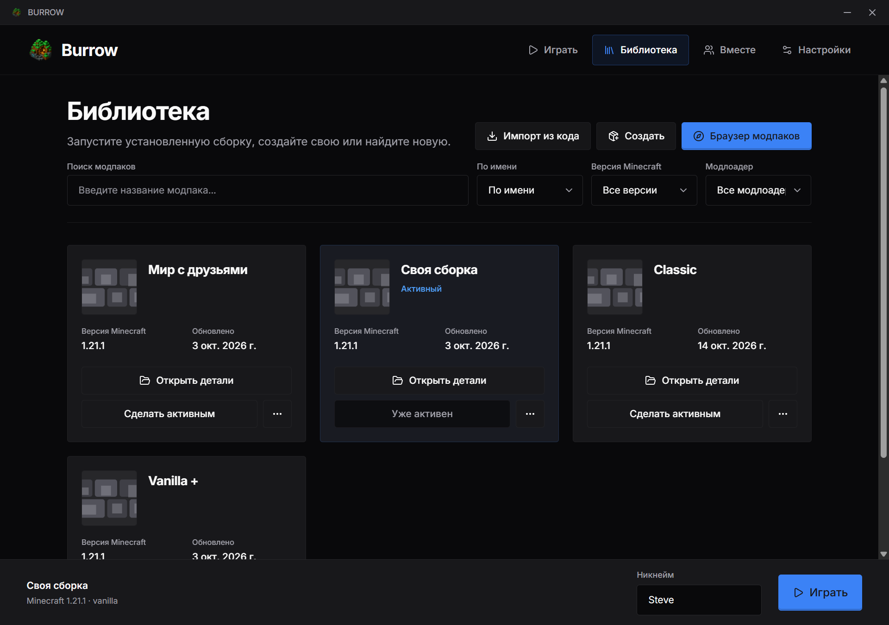
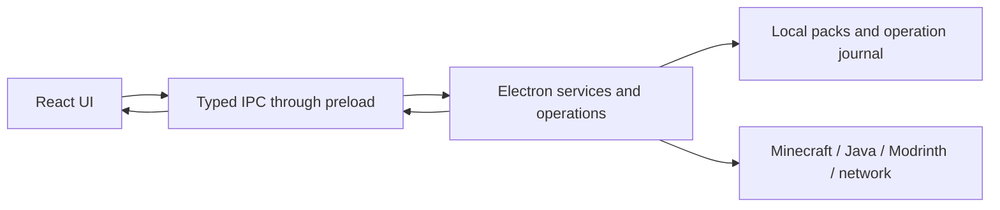

# Burrow

A desktop Minecraft launcher for solo play, your packs and playing with friends.

<p><a href="PLAN.md"></a> <a href="package.json"></a> <a href="docs/AGENT_GUIDE.md"></a> <a href="docs/assets/demo/burrow-next-demo.mp4"></a> <a href="LICENSE"></a> <a href="https://github.com/malyarq/burrow/actions/workflows/ci.yml"></a></p>

**[Demo](docs/assets/demo/burrow-next-demo.mp4) · [Run](#run) · [Architecture](#architecture) · [Plan](PLAN.md) · [For agents](AGENTS.md)**

## Screenshots

0.14.0, synthetic local packs; no real accounts or Minecraft launch. Demo frames were reviewed; human listening is still pending. See [demo checks](docs/assets/demo/provenance.json).

**Play: version, nickname and modloader in one place.**


**Library: compact pack cards and filters.**



**Light theme: the same controls and layout.**


[Capture provenance](docs/assets/screenshots/next/provenance.json). [Demo reproduction](docs/DEMO.md).

## Implemented features

- Game/modloader, memory and launch: [play UI](src/product/PlayWorkspace.tsx), [launcher](electron/services/launcher).
- Local packs, import/export, catalog and contents: [pack UI](src/components/modpacks), [provider service](electron/services/mods/platform/modPlatformService.ts).
- Mods, resource packs, shaders, worlds and screenshots: [services](electron/services).
- Burrow Link connects an open LAN world; [Together](src/product/FriendsWorkspace.tsx) includes a guide. [Network service](electron/services/network/burrowLinkService.ts).
- Themes, accents, saved themes and RU/EN: [settings](src/product/SettingsWorkspace.tsx), [context](src/contexts/SettingsContext.tsx).

## Run

Node.js 24.x, npm 11.x and Git ([package.json](package.json)).

```bash
git clone https://github.com/malyarq/burrow.git
cd burrow
npm ci
npm run dev
```

No keys required for ordinary use. [`.env.example`](.env.example) documents optional variables; Electron main does not load it automatically. See the [agent guide](docs/AGENT_GUIDE.md).

[GitHub Releases](https://github.com/malyarq/burrow/releases/latest) contains legacy-line packages, which differ from Next. They are not the current preview. `npm run build -- --publish never` builds locally without publishing.

The default branch is `main`; the previous version is preserved in the archive branch. [Archive and rollback](docs/REPOSITORY.md).

## Architecture



Actions cross [IPC wrappers](src/services/ipc) and [contracts](shared/contracts). Main validates requests, performs operations and returns updated state. Filesystem ownership stays in main, assembled in one [composition root](electron/app/compositionRoot.ts). [Architecture](docs/en/architecture.md).

## Status and limitations

Version **0.14.0**, **preview, in development**: [package.json](package.json), [PLAN](PLAN.md).

These are code paths, not guarantees for every game version, mod or router. The demo uses synthetic packs and does not launch Minecraft. The latest local Next installer smoke was on Windows; this version still needs macOS/Linux checks. Microsoft authentication and Quilt are unavailable. [Known issues](docs/en/known-issues.md).

The updated XMCL chain reports 0 vulnerabilities in the local production audit on 2026-10-04. Integrity and cancellation are checked with local HTTP fixtures; this does not establish installation compatibility with every game version. [Package provenance and repairs](vendor/README.md), [download fixtures](electron/services/runtime/__tests__/installerIntegrity.fixture.test.ts), [live CI](https://github.com/malyarq/burrow/actions/workflows/ci.yml).

No AI/LLM features run in the application. Guides, filters and validation use ordinary code; generated artwork and narration are production materials only: [PLAN](PLAN.md).

## Development

Read [AGENTS.md](AGENTS.md) and [PLAN.md](PLAN.md) before collaborating. Assign ownership/file boundaries; commit and push small, complete, checked changes to a task branch. [Demo reproduction](docs/DEMO.md), [documentation](docs/README.md), [contributing](CONTRIBUTING.md), [security](SECURITY.md), [changelog](CHANGELOG.md).

The existing [MIT license](LICENSE) applies to code. Minecraft and third-party components retain their own terms: [notices](THIRD_PARTY_NOTICES.md). Burrow is not affiliated with Mojang or Microsoft.

[Checks and commands](docs/AGENT_GUIDE.md) · [CI (repository access required)](https://github.com/malyarq/burrow/actions/workflows/ci.yml). The repository is PRIVATE; the application runs locally.

[Русский](README.md).
