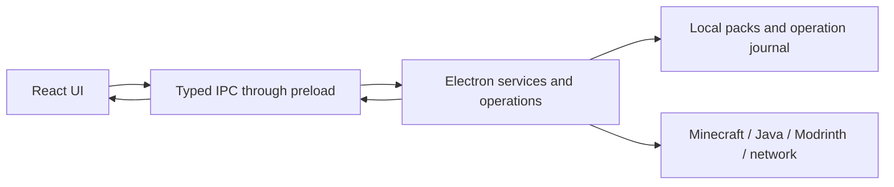

# Burrow

A desktop Minecraft launcher for your own modpacks and playing with friends.

<p><a href="PLAN.md"></a> <a href="package.json"></a> <a href="docs/AGENT_GUIDE.md"></a> <a href="docs/assets/demo/burrow-next-demo.mp4"></a> <a href="LICENSE"></a> <a href="https://github.com/malyarq/burrow/actions/workflows/ci.yml"></a></p>

**[Demo](docs/assets/demo/burrow-next-demo.mp4) · [Features](#implemented-features) · [Run](#run) · [Documentation](docs/README.md#english) · [Limitations](#status-and-limitations)**

## Screenshots

The 0.14.0 interface: play, pack library, and light theme. The [52-second demo](docs/assets/demo/burrow-next-demo.mp4) shows screen navigation and settings. Screenshots and video use fictional local packs; they do not show real accounts or a Minecraft launch. [Demo contents and checks](docs/assets/demo/provenance.json).

**Play: version, nickname and modloader in one place.**


**Library: compact pack cards and filters.**


**Light theme: the same controls and layout.**


[Capture provenance](docs/assets/screenshots/next/provenance.json). [Demo reproduction](docs/DEMO.md).

## Implemented features

- Choose Minecraft and a modloader, enter a nickname, configure memory and Java, and launch the game: [Play screen](src/product/PlayWorkspace.tsx), [launcher service](electron/services/launcher).
- Create a separate pack, install a Modrinth modpack or import a local archive, and export a pack: [library](src/components/modpacks), [catalog and installation](electron/services/mods/platform/modPlatformService.ts).
- Manage mods, resource packs, shaders, worlds, and screenshots within a pack: [content services](electron/services).
- Invite a friend to an open LAN world or join using a Burrow Link code: [Together screen](src/product/FriendsWorkspace.tsx), [connection service](electron/services/network/burrowLinkService.ts).
- Choose light or dark mode, save your colors, and switch between Russian and English: [settings](src/product/SettingsWorkspace.tsx), [settings storage](src/contexts/SettingsContext.tsx).

## Run

Node.js 24.x, npm 11.x and Git: [versions](package.json), [.nvmrc](.nvmrc).

```bash
git clone https://github.com/malyarq/burrow.git
cd burrow
npm ci
npm run dev
```

This runs the current preview from source: `npm run dev` opens Electron through Vite ([configuration](vite.config.ts)). No API keys are required for ordinary use. Optional variables are listed in [`.env.example`](.env.example); commands and environment setup are in the [development guide](docs/en/development.md).

[Older installers in GitHub Releases](https://github.com/malyarq/burrow/releases/latest) belong to the previous product line and remain as an archive. Use the source instructions above for the current preview. `npm run build -- --publish never` builds locally without publishing.

The default branch is `main`; the previous version is preserved in the archive branch. [Archive and rollback](docs/REPOSITORY.md).

## Architecture



Actions cross [IPC wrappers](src/services/ipc) and [contracts](shared/contracts). Main validates requests, performs operations and returns updated state. Filesystem ownership stays in main, assembled in one [composition root](electron/app/compositionRoot.ts). [Architecture](docs/en/architecture.md).

## Status and limitations

Version **0.14.0**, **preview, in development**: [package.json](package.json), [PLAN](PLAN.md).

Microsoft authentication and Quilt are unavailable. The CurseForge catalog is disabled in official builds; archive imports that download mods need an available provider. Burrow Link depends on the network and needs verification on two devices. [Detailed limitations](docs/en/known-issues.md).

[CI](https://github.com/malyarq/burrow/actions/workflows/ci.yml) checks code and the macOS Chromium UI. This does not establish compatibility with every game version, modloader, or network; real game installations and Windows/macOS/Linux packages need separate checks. [Check coverage](docs/en/testing.md), [verified behavior and remaining work](PLAN.md).

## Development

Commands, environment setup, and project structure are in the [development guide](docs/en/development.md) and [architecture](docs/en/architecture.md). Read [contributing](CONTRIBUTING.md) and [AGENTS.md](AGENTS.md) before making changes. [Demo reproduction](docs/DEMO.md).

[Documentation](docs/README.md#english) · [Contributing](CONTRIBUTING.md) · [Security](SECURITY.md) · [Changelog](CHANGELOG.md)

The existing [MIT license](LICENSE) applies to code. Minecraft and third-party components retain their own terms: [notices](THIRD_PARTY_NOTICES.md). Burrow is not affiliated with Mojang or Microsoft.

[Checks and commands](docs/AGENT_GUIDE.md) · [CI (repository access required)](https://github.com/malyarq/burrow/actions/workflows/ci.yml). The repository is PRIVATE; the application runs locally.

[Русский](README.md).
