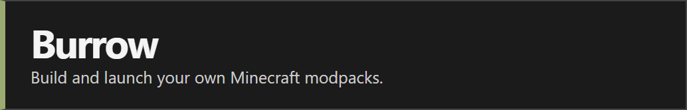

[](https://github.com/376east/burrow/actions/workflows/ci.yml) [](package.json)

**[Download Burrow](https://github.com/376east/burrow/releases/latest)** · [Русский](README.ru.md)

Build and manage Minecraft modpacks in one desktop launcher. Choose a game version and modloader, install Modrinth packs, and manage mods and worlds from the library.

## Run

Download the Windows Setup, macOS DMG, or Linux AppImage for your platform. To run Burrow from source, use the commands below.

Requires Node.js 24 and npm 11.

```sh
git clone https://github.com/376east/burrow.git
cd burrow
npm ci
npm run dev
```

Microsoft sign-in and Quilt are currently unavailable. [Known limitations](docs/en/known-issues.md)

## Project links

[Changelog](CHANGELOG.md) · [Development](docs/en/development.md) · [MIT](LICENSE) · [Third-party notices](THIRD_PARTY_NOTICES.md)
