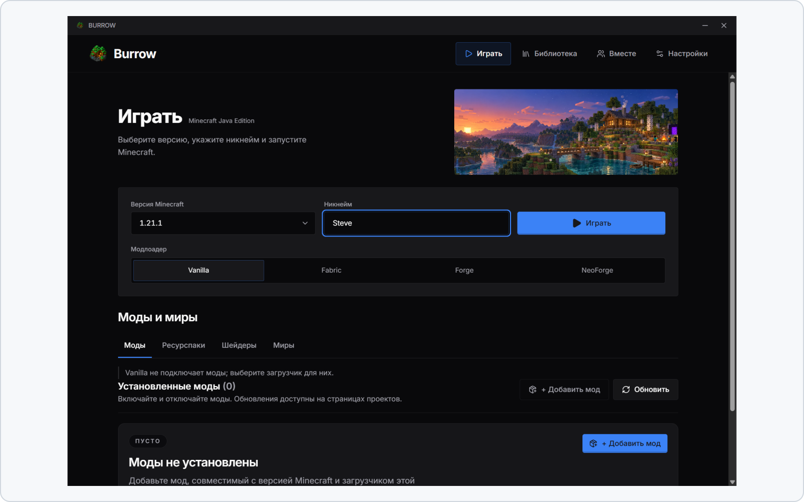
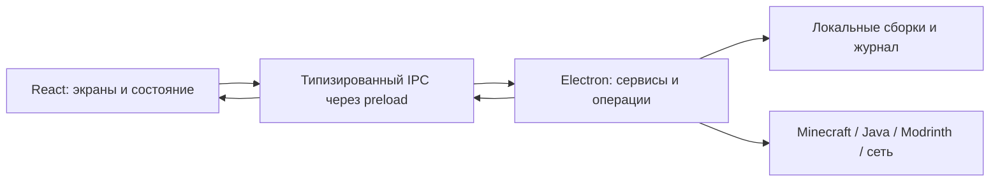

# Burrow

Настольный лаунчер Minecraft для своих сборок и игры с друзьями.

<p><a href="#статус-и-ограничения"></a> <a href="https://github.com/malyarq/burrow/actions/workflows/ci.yml"></a> <a href="package.json"></a> <a href="docs/assets/readme/current-flow.mp4"></a></p>

**[Скриншоты](#как-выглядит) · [Возможности](#что-работает) · [Запуск](#запуск) · [Архитектура](#архитектура) · [Ограничения](#статус-и-ограничения) · [Разработка](#разработка)**

## Как выглядит

<a href="docs/assets/readme/overview.svg"></a>

Экран запуска объясняет готовность к подготовке, а после ошибки предлагает проверить настройки, открыть журнал и повторить запуск. Здесь показан renderer-fixture с вымышленной сборкой и учебным сбоем. Это снимки тестового интерфейса, они не подтверждают настоящий запуск Minecraft. [Источник снимков](docs/assets/readme/prototype-transfer.json).

**[Актуальное демо MP4](docs/assets/readme/current-flow.mp4)** · 00:21 · 26 октября 2026 · [Источник записи](docs/assets/readme/current-flow.json)

[Предыдущее демо, 00:52](docs/assets/demo/burrow-next-demo.mp4) · [Материалы демо](docs/DEMO.md)

<details>
<summary>Ещё два экрана</summary>

**Ошибка запуска и повтор.**

<a href="docs/assets/readme/screen-2.svg"></a>

**Восстановление на узком экране.**

<a href="docs/assets/readme/screen-3.svg"></a>

</details>

## Что работает

- **Основное:** выбрать Minecraft и модлоадер, указать никнейм, настроить память и Java, запустить игру. [Экран запуска](src/product/PlayWorkspace.tsx), [сервис запуска](electron/services/launcher).
- **Дополнительно:** создавать и импортировать сборки, устанавливать модпаки Modrinth, управлять модами, ресурспаками, шейдерами, мирами и скриншотами, экспортировать сборку и подключаться по Burrow Link; менять тему и язык. [Библиотека](src/components/modpacks), [контент](electron/services), [совместная игра](src/product/FriendsWorkspace.tsx), [настройки](src/product/SettingsWorkspace.tsx).
- **Данные:** локальные сборки, настройки и журнал операций; UI обращается к сервисам Electron через типизированный IPC. [Архитектура](docs/ru/architecture.md).

## Запуск

### Требования

Нужны Node.js 24.x, npm 11.x и Git: [версии](package.json), [.nvmrc](.nvmrc).

### Быстрый старт

```powershell
git clone https://github.com/malyarq/burrow.git
cd burrow
npm ci
npm run dev
```

### Данные и доступ

Это запуск текущего preview из исходников: `npm run dev` открывает приложение Electron через Vite ([конфигурация](vite.config.ts)). Для обычного запуска API-ключи не нужны. Необязательные переменные описаны в [`.env.example`](.env.example), команды и окружение - в [руководстве по разработке](docs/ru/development.md).

[Старые установщики в GitHub Releases](https://github.com/376east/burrow/releases/latest) относятся к прежней линии и оставлены как архив. Для текущего preview используйте исходники выше. Локальная сборка без публикации: `npm run build -- --publish never`.

Основная ветка GitHub - `main`; прежняя версия сохранена в архивной ветке. [Архив и точная команда отката](docs/REPOSITORY.md).

## Архитектура



Кнопка отправляет запрос через [IPC-обёртку](src/services/ipc) и [общий контракт](shared/contracts). Main проверяет запрос, выполняет операцию и возвращает новое состояние. Файлы остаются у main; UI использует идентификаторы сборок. Владельцы создаются в одном [composition root](electron/app/compositionRoot.ts). [Подробная архитектура](docs/ru/architecture.md).

## Статус и ограничения

| Параметр | Состояние |
| --- | --- |
| Стадия | В разработке. [План](PLAN.md). |
| Версия | 0.14.0, preview. [package.json](package.json). |
| Лицензия | MIT для собственного кода. [LICENSE](LICENSE), [сторонние компоненты](THIRD_PARTY_NOTICES.md). |

### Ограничения

Microsoft-вход отсутствует, Quilt не поддерживается. Каталог CurseForge отключён в официальной сборке; импорт архивов с загрузкой модов требует доступного провайдера. Burrow Link зависит от сети и требует проверки на двух устройствах. [Подробные ограничения](docs/ru/known-issues.md).

Автоматические проверки кода и macOS Chromium UI выполняет [CI](https://github.com/malyarq/burrow/actions/workflows/ci.yml). Совместимость всех игровых версий, модлоадеров и сетей этим не подтверждается; настоящие игровые установки и пакеты на Windows/macOS/Linux проверяются отдельно. [Состав проверок](docs/ru/testing.md), [проверенное и оставшиеся задачи](PLAN.md).

## Разработка

[Документация](docs/README.md) · [План](PLAN.md) · [Правила](AGENTS.md) · [CI](https://github.com/malyarq/burrow/actions/workflows/ci.yml)

<details>
<summary>Проверки и работа над проектом</summary>

Команды, окружение и устройство проекта описаны в [руководстве по разработке](docs/ru/development.md) и [архитектуре](docs/ru/architecture.md). Перед изменениями прочитайте [правила участия](CONTRIBUTING.md) и [AGENTS.md](AGENTS.md). [Как переснять демо](docs/DEMO.md).

[Документация](docs/README.md) · [Участие](CONTRIBUTING.md) · [Безопасность](SECURITY.md) · [Изменения](CHANGELOG.md)

Для кода сохранена существующая [MIT-лицензия](LICENSE). Minecraft и сторонние компоненты сохраняют свои права: [уведомления](THIRD_PARTY_NOTICES.md). Burrow не связан с Mojang или Microsoft.

[Проверки и команды](docs/AGENT_GUIDE.md#проверки) · [CI (требует доступа к репозиторию)](https://github.com/malyarq/burrow/actions/workflows/ci.yml). Репозиторий PRIVATE; приложение запускается локально.

[English](README.en.md).

</details>
