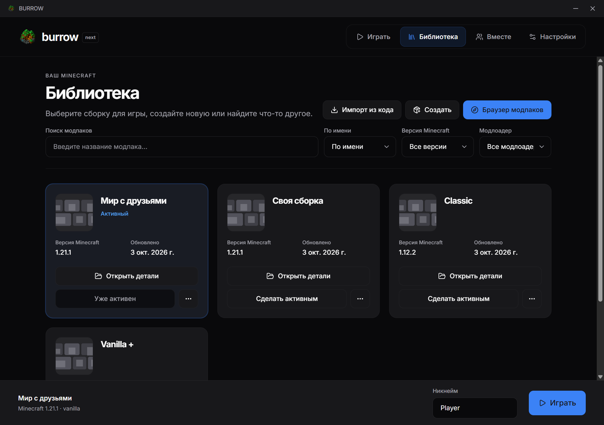
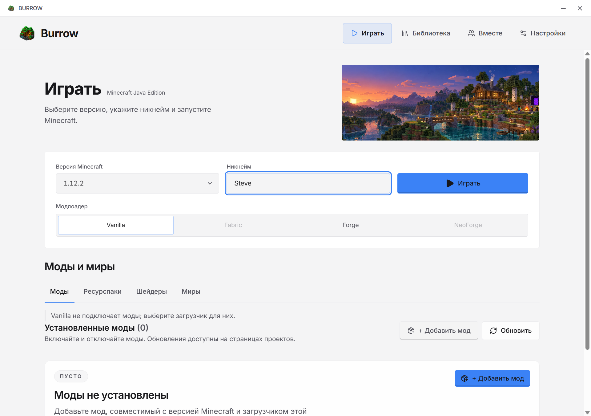
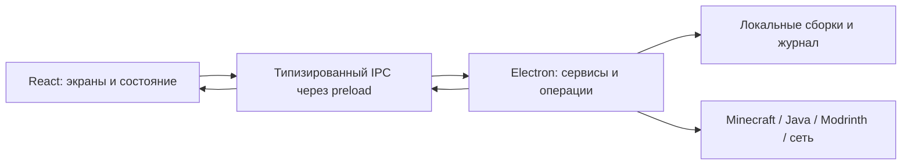

# Burrow

Настольный лаунчер Minecraft для своих сборок и игры с друзьями.

<p><a href="PLAN.md"></a> <a href="package.json"></a> <a href="docs/AGENT_GUIDE.md"></a> <a href="docs/assets/demo/burrow-next-demo.mp4"></a> <a href="LICENSE"></a> <a href="https://github.com/malyarq/burrow/actions/workflows/ci.yml"></a></p>

**[Демо](docs/assets/demo/burrow-next-demo.mp4) · [Что работает](#что-работает) · [Запуск](#запуск) · [Документация](docs/README.md) · [Ограничения](#статус-и-ограничения)**

## Как выглядит

Интерфейс 0.14.0: игра, библиотека сборок и светлая тема. [Демо, 52 секунды](docs/assets/demo/burrow-next-demo.mp4) показывает переходы между экранами и настройки. На снимках и в ролике используются вымышленные локальные сборки; настоящие аккаунты и запуск Minecraft не показаны. [Состав и проверки демо](docs/assets/demo/provenance.json).

**Играть: версия, никнейм и модлоадер рядом.**


**Библиотека: компактные карточки и фильтры сборок.**



**Светлая тема: те же элементы и расположение.**



[Источник снимков](docs/assets/screenshots/next/provenance.json). [Как переснять демо](docs/DEMO.md).

## Что работает

- Выбрать Minecraft и модлоадер, указать никнейм, настроить память и Java, запустить игру: [экран «Играть»](src/product/PlayWorkspace.tsx), [сервис запуска](electron/services/launcher).
- Создать отдельную сборку, установить модпак из Modrinth или импортировать локальный архив; экспортировать сборку: [библиотека](src/components/modpacks), [каталог и установка](electron/services/mods/platform/modPlatformService.ts).
- Управлять модами, ресурспаками, шейдерами, мирами и скриншотами внутри сборки: [сервисы контента](electron/services).
- Пригласить друга в открытый LAN-мир или подключиться по коду Burrow Link: [экран «Вместе»](src/product/FriendsWorkspace.tsx), [сервис соединения](electron/services/network/burrowLinkService.ts).
- Выбрать светлую или тёмную тему, сохранить свои цвета и переключить русский/английский: [настройки](src/product/SettingsWorkspace.tsx), [хранение настроек](src/contexts/SettingsContext.tsx).

## Запуск

Нужны Node.js 24.x, npm 11.x и Git: [версии](package.json), [.nvmrc](.nvmrc).

```bash
git clone https://github.com/malyarq/burrow.git
cd burrow
npm ci
npm run dev
```

Это запуск текущего preview из исходников: `npm run dev` открывает приложение Electron через Vite ([конфигурация](vite.config.ts)). Для обычного запуска API-ключи не нужны. Необязательные переменные описаны в [`.env.example`](.env.example), команды и окружение - в [руководстве по разработке](docs/ru/development.md).

[Старые установщики в GitHub Releases](https://github.com/malyarq/burrow/releases/latest) относятся к прежней линии и оставлены как архив. Для текущего preview используйте исходники выше. Локальная сборка без публикации: `npm run build -- --publish never`.

Основная ветка GitHub - `main`; прежняя версия сохранена в архивной ветке. [Архив и точная команда отката](docs/REPOSITORY.md).

## Архитектура



Кнопка отправляет запрос через [IPC-обёртку](src/services/ipc) и [общий контракт](shared/contracts). Main проверяет запрос, выполняет операцию и возвращает новое состояние. Файлы остаются у main; UI использует идентификаторы сборок. Владельцы создаются в одном [composition root](electron/app/compositionRoot.ts). [Подробная архитектура](docs/ru/architecture.md).

## Статус и ограничения

Текущая версия **0.14.0**, стадия **preview, в разработке**: [package.json](package.json), [PLAN](PLAN.md).

Microsoft-вход отсутствует, Quilt не поддерживается. Каталог CurseForge отключён в официальной сборке; импорт архивов с загрузкой модов требует доступного провайдера. Burrow Link зависит от сети и требует проверки на двух устройствах. [Подробные ограничения](docs/ru/known-issues.md).

Автоматические проверки кода и macOS Chromium UI выполняет [CI](https://github.com/malyarq/burrow/actions/workflows/ci.yml). Совместимость всех игровых версий, модлоадеров и сетей этим не подтверждается; настоящие игровые установки и пакеты на Windows/macOS/Linux проверяются отдельно. [Состав проверок](docs/ru/testing.md), [проверенное и оставшиеся задачи](PLAN.md).

## Разработка

Команды, окружение и устройство проекта описаны в [руководстве по разработке](docs/ru/development.md) и [архитектуре](docs/ru/architecture.md). Перед изменениями прочитайте [правила участия](CONTRIBUTING.md) и [AGENTS.md](AGENTS.md). [Как переснять демо](docs/DEMO.md).

[Документация](docs/README.md) · [Участие](CONTRIBUTING.md) · [Безопасность](SECURITY.md) · [Изменения](CHANGELOG.md)

Для кода сохранена существующая [MIT-лицензия](LICENSE). Minecraft и сторонние компоненты сохраняют свои права: [уведомления](THIRD_PARTY_NOTICES.md). Burrow не связан с Mojang или Microsoft.

[Проверки и команды](docs/AGENT_GUIDE.md#проверки) · [CI (требует доступа к репозиторию)](https://github.com/malyarq/burrow/actions/workflows/ci.yml). Репозиторий PRIVATE; приложение запускается локально.

[English](README.en.md).
