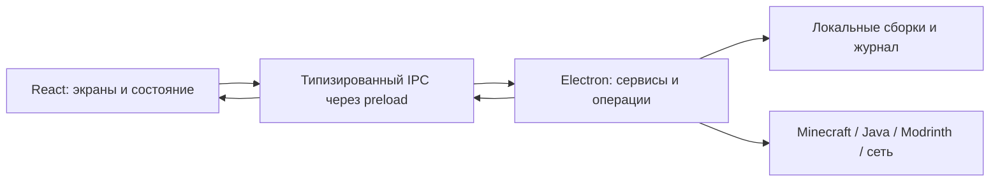

# Burrow

Настольный лаунчер Minecraft для игры соло, своих сборок и игры с друзьями.

<p><a href="PLAN.md"></a> <a href="package.json"></a> <a href="docs/AGENT_GUIDE.md"></a> <a href="docs/assets/demo/burrow-next-demo.mp4"></a> <a href="LICENSE"></a> <a href="https://github.com/malyarq/burrow/actions/workflows/ci.yml"></a></p>

**[Демо](docs/assets/demo/burrow-next-demo.mp4) · [Запуск](#запуск) · [Архитектура](#архитектура) · [План](PLAN.md) · [Для агента](AGENTS.md)**

## Как выглядит

Next.6, синтетические локальные сборки. Без настоящих аккаунтов и запуска Minecraft.

**Играть: версия, никнейм и модлоадер рядом.**


**Библиотека: компактные карточки и фильтры сборок.**


**Светлая тема: те же элементы и расположение.**


[Источник снимков](docs/assets/screenshots/next/provenance.json). [Как переснять демо](docs/DEMO.md).

## Что работает

- Выбор Minecraft/модлоадера, память и запуск: [экран игры](src/product/PlayWorkspace.tsx), [launcher](electron/services/launcher).
- Локальные сборки, импорт/экспорт, каталог и состав модпаков: [библиотека](src/components/modpacks), [провайдерный сервис](electron/services/mods/platform/modPlatformService.ts).
- Моды, ресурспаки, шейдеры, миры и скриншоты: [сервисы контента](electron/services).
- Burrow Link для подключения к открытому LAN-миру, с инструкцией рядом: [«Вместе»](src/product/FriendsWorkspace.tsx), [сеть](electron/services/network/burrowLinkService.ts).
- Темы, акценты, сохранённые темы, русский и английский: [настройки](src/product/SettingsWorkspace.tsx), [контекст](src/contexts/SettingsContext.tsx).

## Запуск

Нужны Node.js 24.x, npm 11.x и Git: [версии](package.json), [.nvmrc](.nvmrc).

```bash
git clone https://github.com/malyarq/burrow.git
cd burrow
npm ci
npm run dev
```

Для обычного запуска API-ключи не нужны. [`.env.example`](.env.example) описывает необязательные переменные; main не читает этот файл автоматически. Команды и окружение - во [входе для агента](docs/AGENT_GUIDE.md).

[GitHub Releases](https://github.com/malyarq/burrow/releases/latest) содержит пакеты прежней линии. Они не являются актуальной Next-preview; старые релизы оставлены как архив. Локальная сборка без публикации: `npm run build -- --publish never`.

Основная ветка GitHub - `main`; прежняя версия сохранена в архивной ветке. [Архив и точная команда отката](docs/REPOSITORY.md).

## Архитектура



Кнопка отправляет запрос через [IPC-обёртку](src/services/ipc) и [общий контракт](shared/contracts). Main проверяет запрос, выполняет операцию и возвращает новое состояние. Файлы остаются у main; UI использует идентификаторы сборок. Владельцы создаются в одном [composition root](electron/app/compositionRoot.ts). [Подробная архитектура](docs/ru/architecture.md).

## Статус и ограничения

Текущая версия **1.0.0-next.7**, стадия **preview, в разработке**: [package.json](package.json), [PLAN](PLAN.md).

Это реализованные пути в коде, не обещание совместимости со всеми играми, модами и роутерами. Демо использует синтетические сборки без запуска Minecraft. Последний локальный smoke установщика Next выполнен на Windows; macOS/Linux требуют проверки этой версии. Microsoft-вход отсутствует, Quilt не поддерживается. [Остальные ограничения](docs/ru/known-issues.md).

Цепочка XMCL обновлена: локальный production audit на 04.10.2026 сообщает 0 уязвимостей. Проверки целостности и отмены выполняются на локальном HTTP-стенде; это не подтверждает установку всех игровых версий. [Исходник и поправки пакета](vendor/README.md), [проверки загрузок](electron/services/runtime/__tests__/installerIntegrity.fixture.test.ts), [живой CI](https://github.com/malyarq/burrow/actions/workflows/ci.yml).

AI/LLM-функций в приложении нет. Инструкции, фильтры и проверки выполняются обычной логикой; генерация иллюстрации и озвучки используется только при подготовке материалов: [PLAN](PLAN.md).

## Разработка

Прочитай [AGENTS.md](AGENTS.md), затем [PLAN.md](PLAN.md). У задачи должен быть владелец и границы файлов. Небольшие законченные изменения коммитим и пушим в рабочую ветку; чужую работу не перезаписываем. [Как переснять демо](docs/DEMO.md).

[Документация](docs/README.md) · [Участие](CONTRIBUTING.md) · [Безопасность](SECURITY.md) · [Изменения](CHANGELOG.md)

Для кода сохранена существующая [MIT-лицензия](LICENSE). Minecraft и сторонние компоненты сохраняют свои права: [уведомления](THIRD_PARTY_NOTICES.md). Burrow не связан с Mojang или Microsoft.

[Проверки и команды](docs/AGENT_GUIDE.md#проверки) · [CI (требует доступа к репозиторию)](https://github.com/malyarq/burrow/actions/workflows/ci.yml). Репозиторий PRIVATE; приложение запускается локально.

[English](README.en.md).
