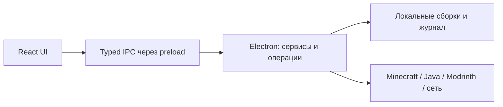

# Burrow

**Играй локально. Зови друга.**

Настольный лаунчер Minecraft для игры соло, своих сборок и игры с друзьями. Текущая разработка - **Burrow Next**: играть, библиотека, вместе, настройки. Стабильная линия сохранена в `main`, текущий продукт и документация находятся в [`rebuild/burrow-next`](https://github.com/malyarq/burrow/tree/rebuild/burrow-next).

[README Next](https://github.com/malyarq/burrow/blob/rebuild/burrow-next/README.md) · [PLAN для ревью Данила](https://github.com/malyarq/burrow/blob/rebuild/burrow-next/PLAN.md) · [Вход для агента](https://github.com/malyarq/burrow/blob/rebuild/burrow-next/docs/AGENT_GUIDE.md) · [Демо с озвучкой, 45 секунд](https://raw.githubusercontent.com/malyarq/burrow/rebuild/burrow-next/docs/assets/demo/burrow-next-demo.mp4) · [English](README.en.md)

## Архитектура



UI отправляет запрос, main проверяет его и работает с файлами или провайдером, затем возвращает состояние. Подробный путь данных и владельцы - в [архитектуре Next](https://github.com/malyarq/burrow/blob/rebuild/burrow-next/docs/ru/architecture.md). LLM-функции в лаунчере не реализованы; генерация иллюстрации и голоса относится к созданию материалов: [PLAN](https://github.com/malyarq/burrow/blob/rebuild/burrow-next/PLAN.md).

## Запустить текущий продукт

```bash
git clone https://github.com/malyarq/burrow.git
cd burrow
git switch rebuild/burrow-next
npm ci
npm run dev
```

Нужны Node.js 24.x и npm 11.x. API-ключи для обычного запуска не требуются. Сборка, окружение и проверки - во [входе для агента](https://github.com/malyarq/burrow/blob/rebuild/burrow-next/docs/AGENT_GUIDE.md).

Next проверяли локально на Windows; эта версия требует отдельной проверки macOS/Linux и полного игрового маршрута. Microsoft-вход отсутствует. Production audit пока падает на цепочке XMCL; это отмечено в [плане](https://github.com/malyarq/burrow/blob/rebuild/burrow-next/PLAN.md). Демо использует синтетические сборки и не запускает игру.

[GitHub Releases](https://github.com/malyarq/burrow/releases/latest) содержит опубликованные пакеты стабильной линии. Их номер может отличаться от Next. Стабильная документация - в [docs](docs/README.md). Как переснять актуальное демо - в [сценарии](https://github.com/malyarq/burrow/blob/rebuild/burrow-next/docs/DEMO.md).

Для совместной работы прочитай [AGENTS.md](AGENTS.md): владелец и границы задачи, отдельная ветка, небольшие проверенные коммиты и push. Чужую работу не перезаписываем.

Сохранена существующая [MIT-лицензия](LICENSE). Minecraft и сторонние компоненты сохраняют свои права: [уведомления](THIRD_PARTY_NOTICES.md). Burrow не связан с Mojang или Microsoft.
